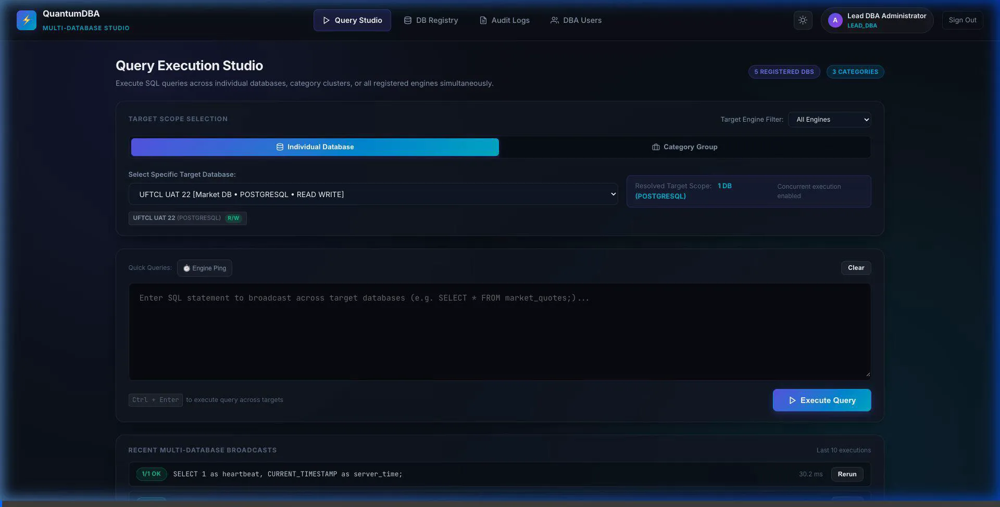
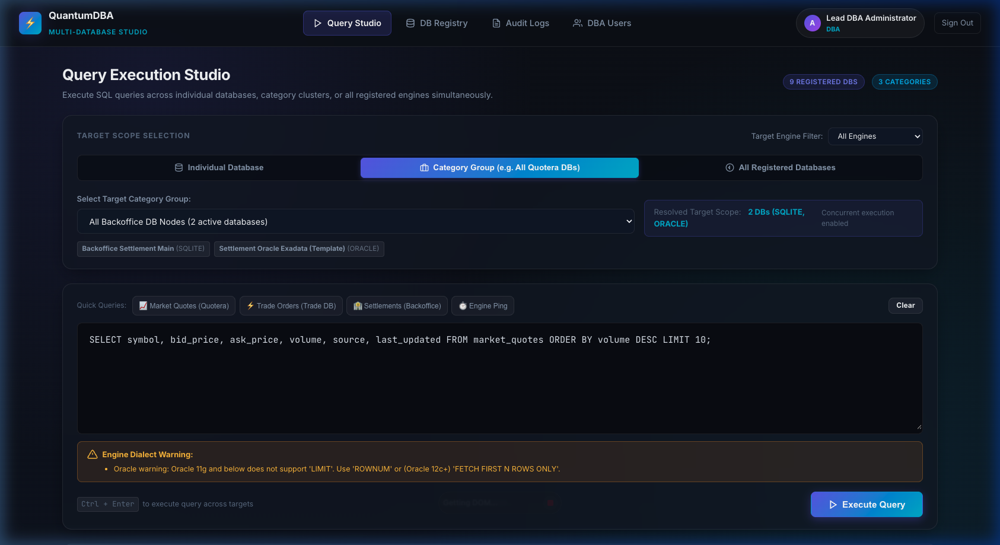
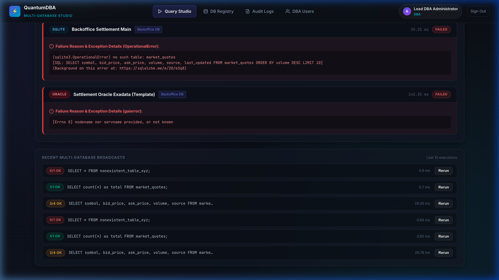
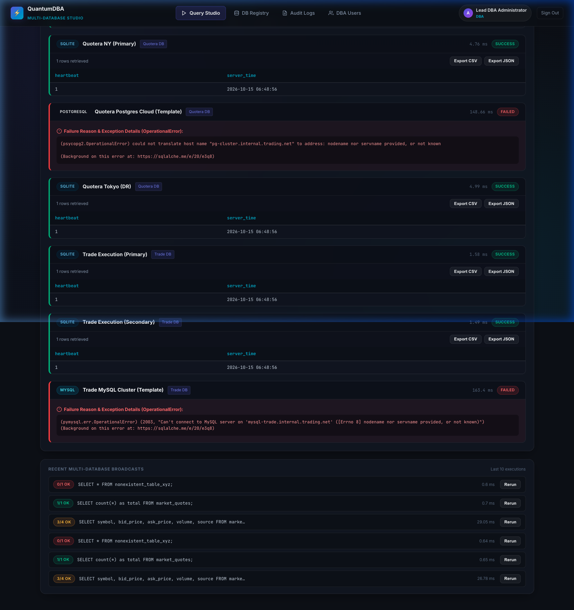
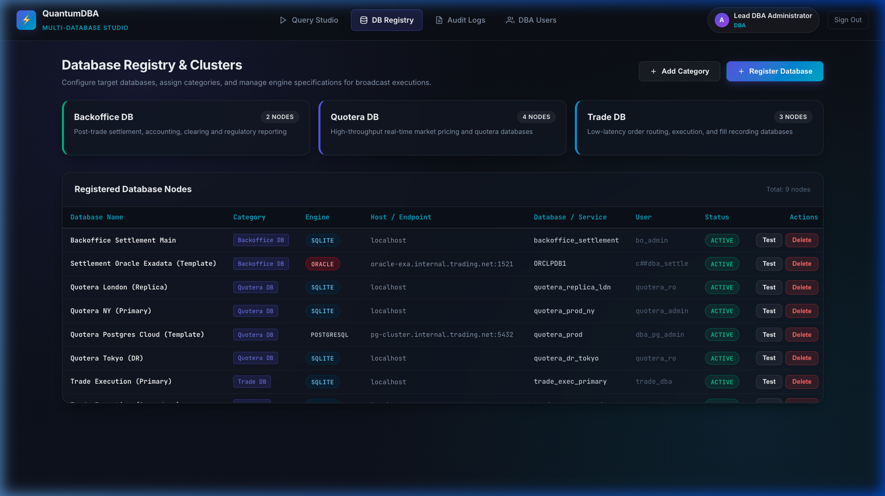
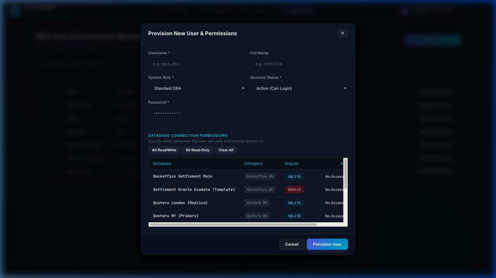
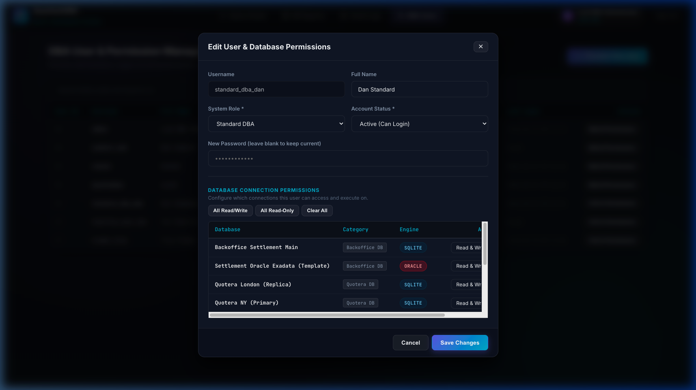
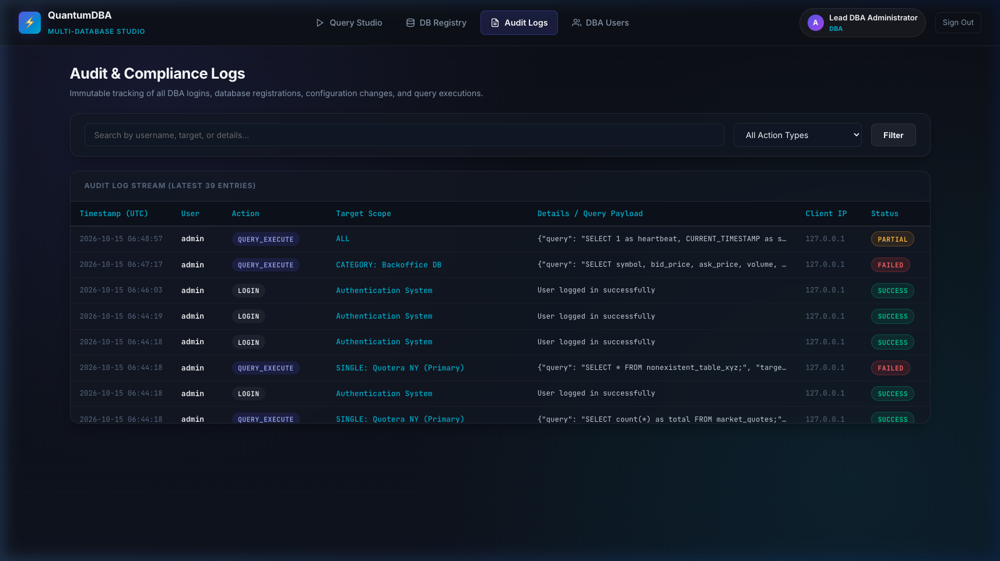

# Multi-Database Query Management Platform (QuantumDBA)

A centralized, high-performance web platform that empowers Database Administrators (DBAs) to execute, broadcast, and monitor SQL queries simultaneously across multiple database instances of the same or different types, grouped by operational categories (e.g., Quotera DB, Trade DB, Backoffice DB) or targeting specific nodes.

---

## Key Features

- **Multi-Target Query Broadcast**:
  - Target a **specific individual database**, an entire **category cluster** (e.g., all Quotera DBs), or **all registered databases** simultaneously.
  - Concurrent multi-threaded query execution engine (`ThreadPoolExecutor`) ensures queries across 10+ databases complete in parallel without head-of-line blocking.
- **Engine Awareness & Pre-Flight Dialect Inspection**:
  - Native engine awareness for **PostgreSQL, MySQL, Oracle**, and **SQLite**.
  - Real-time pre-flight dialect analyzer warns of engine-specific constructs (e.g., `LIMIT` vs `ROWNUM` / `FETCH FIRST` on Oracle, PostgreSQL `ILIKE` vs MySQL `LIKE`, or backtick quoting friction).
- **Role-Based Access Control (RBAC) & Granular Scoping**:
  - **Super Admin (`lead_dba`)**: Exclusive authority to register, edit, and delete database connections, provision users, toggle active/inactive access, and configure per-database permissions.
  - **Standard DBA (`dba`)**: Can only view and execute queries on databases explicitly assigned to them by the Super Admin.
  - **Auditor (`auditor`)**: Read-only queries (`SELECT` only) on permitted databases.
- **Per-User Database Permission Scoping**:
  - Super Admin can configure access per database (*No Access / Hidden*, *Read-Only*, or *Read & Write*).
  - Quick preset buttons: **All Read/Write**, **All Read-Only**, or **Clear All**.
  - Write queries (`INSERT`, `UPDATE`, `DELETE`, `DROP`, `ALTER`, etc.) are automatically blocked on read-only databases with explicit error diagnostics.
- **Audit & Compliance Logging with Role Scoping**:
  - Immutable tracking of all logins, connection tests, configuration edits, user management, and broadcast queries.
  - Super Admin has global visibility across all users; standard DBAs and Auditors see only their own personal activity stream and query history.
- **Detailed Execution Reporting & Error Diagnostics**:
  - Execution summary pills (Total Targets, Succeeded count, Failed count, Latency in ms).
  - Interactive data tables with sticky headers, per-database CSV and JSON exports, and failure diagnosis traces.

---

## Visual Tour & Interface

### End-to-End Workflow Recording


---

### 1. Query Execution Studio
Execute and broadcast queries across individual databases, category clusters, or all registered engines simultaneously with real-time target resolution and dialect feedback.



---

### 2. Execution Results & Export
Per-node results card with status badges, execution duration, interactive data tables, CSV/JSON export, and detailed failure diagnostics for unreachable nodes or syntax friction.



---

### 3. All-Engine Concurrent Broadcast (Ping / Latency Check)
Broadcast health checks and queries across heterogeneous database engines (PostgreSQL, MySQL, Oracle, SQLite) concurrently.



---

### 4. Database Registry & Categorization (Super Admin)
Manage database clusters, connection parameters, engine specifications, and run live connection heartbeat tests.



---

### 5. DBA User Provisioning & Granular Permissions
Provision administrators and assign database access levels using quick presets (All Read/Write, All Read-Only) or individual node toggles.

<p align="center">
  
  
</p>

---

### 6. Scoped Audit & Compliance Logging
Track system activity with action filters (`LOGIN`, `QUERY_EXECUTE`, `DB_CREATE`, `DB_UPDATE`, `DB_DELETE`, `USER_CREATE`, `TEST_CONNECTION`).



---

## Permissions Matrix

| Feature / Capability | Super Admin (`lead_dba`) | Standard DBA (`dba`) | Auditor (`auditor`) |
| :--- | :---: | :---: | :---: |
| **Execute `SELECT` Queries** | All Databases | Permitted Databases | Permitted Databases (Read-Only) |
| **Execute Write Queries (`INSERT`, `UPDATE`, DDL)** | All Databases | Permitted R/W Databases Only | **Blocked** (`Permission Denied`) |
| **Database Registry (Add / Edit / Delete)** | **Yes** | **No** (Hidden & Restricted) | **No** (Hidden & Restricted) |
| **User Administration (`/users`)** | **Yes** | **No** (Access Denied) | **No** (Access Denied) |
| **Audit Logs Visibility** | **Global** (All Users) | **Personal Stream Only** | **Personal Stream Only** |
| **Target Scope in Query Studio** | All Registered DBs | Permitted DBs Only | Permitted DBs Only |

---

## Quick Start Guide

### Prerequisites
- Python 3.9+
- SQLite3

### 1. Clone & Set Up Virtual Environment
```bash
git clone <repository-url>
cd "Query management platform"

# Create virtual environment
python3 -m venv venv
source venv/bin/activate

# Install dependencies
pip install -r requirements.txt
```

### 2. Initialize Seed Databases & Super Admin Account
```bash
python3 init_db.py
```
This initializes the metadata database and preloads realistic sample financial databases (`Quotera NY`, `Quotera London`, `Quotera Tokyo`, `Trade Execution Primary`, `Backoffice Settlement Main`) along with connection templates for PostgreSQL, MySQL, and Oracle.

### 3. Run Application Server
```bash
python3 app.py
```
The application will start on **`http://127.0.0.1:5001`**.

---

## Default Administrator Credentials

| Role | Username | Password | Access Level |
| :--- | :--- | :--- | :--- |
| **Super Admin** | `admin` | `admin123` | Full Organization Authority (All DBs & Users) |

*(Additional accounts can be provisioned via the DBA Users console)*.

---

## Running the Automated Test Suite

The platform includes an extensive test suite covering authentication, multi-target execution, dialect analysis, error diagnostics, active/inactive status enforcement, per-database permissions, and audit log scoping:

```bash
python3 -m unittest tests/test_platform.py
```

---

## Project Structure

```
├── app.py                     # Flask application routes, decorators & auth
├── models.py                  # Database schemas, UserModel, PermissionModel, AuditModel
├── db_manager.py              # Engine dialect helper, connection factory, concurrent executor
├── init_db.py                 # Initial database seeder and demo financial nodes
├── requirements.txt           # Python dependencies
├── docs/
│   └── screenshots/           # Application screenshots and visual assets
├── static/
│   ├── css/style.css          # Design system, glassmorphism, dark theme styling
│   └── js/app.js              # Client-side targeting controls, AJAX executor, export
├── templates/
│   ├── base.html              # Core navigation layout & alerts
│   ├── login.html             # Secure DBA sign-in interface
│   ├── dashboard.html         # Query Execution Studio
│   ├── databases.html         # Database Registry & Configuration
│   ├── audit.html             # Immutable audit log stream
│   └── users.html             # User administration & permission matrix
└── tests/
    └── test_platform.py       # 11 unit & integration tests
```
